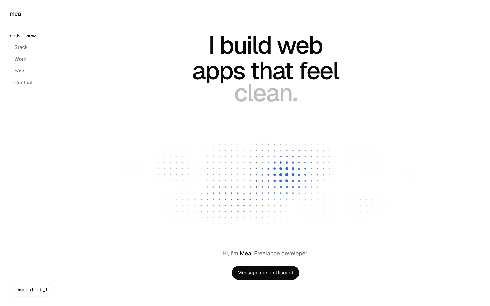
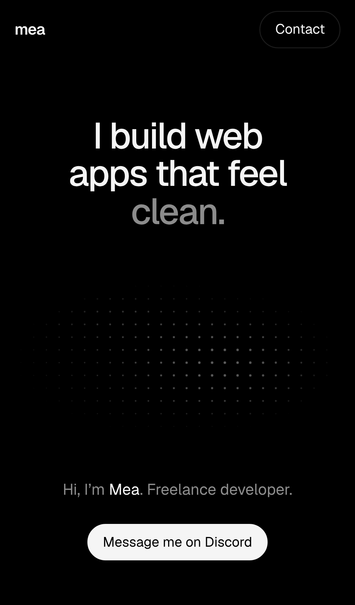

<picture>
  <source media="(prefers-color-scheme: dark)" srcset="./.github/assets/header-dark.svg">
  
</picture>

 

### About

Freelance developer. I build websites and web apps from the first screen to the server: small codebases, quick load times, and interfaces that feel effortless.

 

### Portfolio

<picture>
  <source media="(prefers-color-scheme: dark)" srcset="./.github/assets/shot-hero-dark.png">
  
</picture>

<table>
  <tr>
    <td width="40%"></td>
    <td width="40%"></td>
    <td width="20%"></td>
  </tr>
</table>

▶ <a href="./.github/assets/demo-copy.mp4">Watch the full-quality video</a>

Built with Vite. Source in this repository.

 

### Preferred stack

  

| | |
|---|---|
| **TypeScript / TSX** | Typed React components, end to end |
| **Vite** | Instant dev server, lean production builds |
| **Tailwind CSS** | Consistent, responsive UI without the bloat |
| **Node.js** | APIs and server logic in the same language |

 

### Work with me

Available for freelance projects: websites, landing pages and web apps.

**Discord** &nbsp;`qb_f`

 

mea · freelance developer
