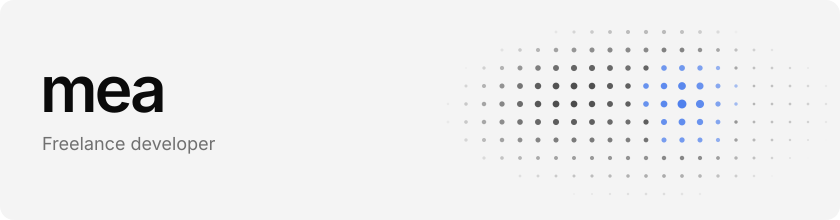
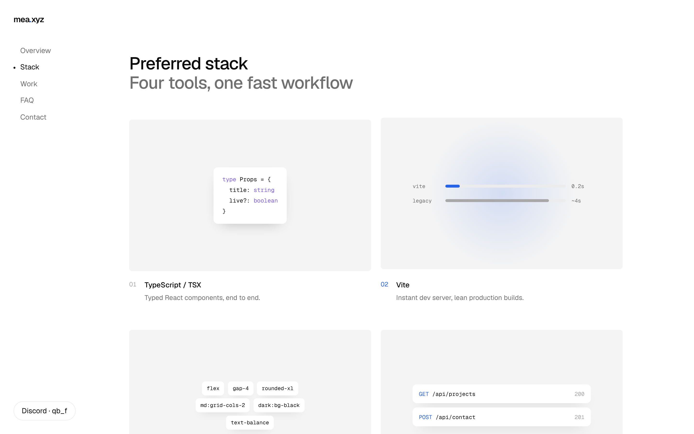
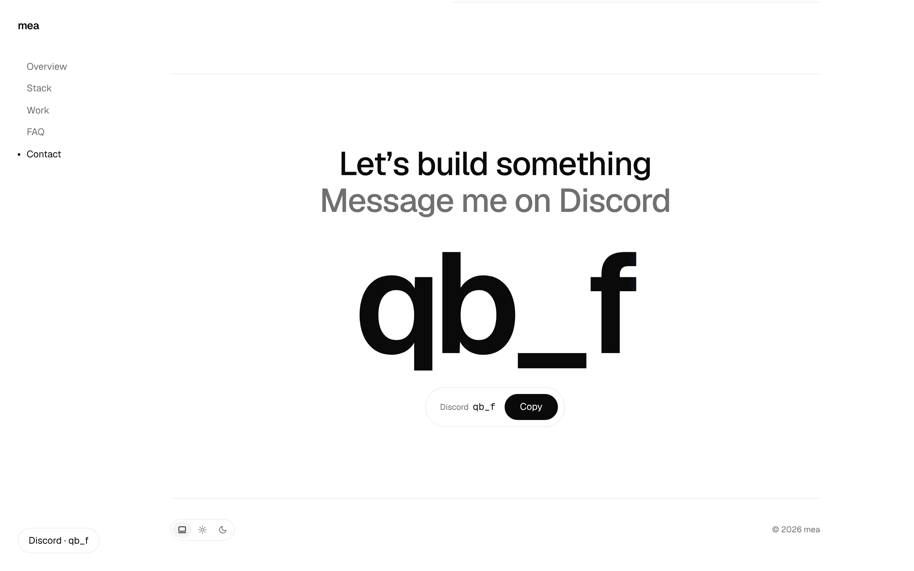
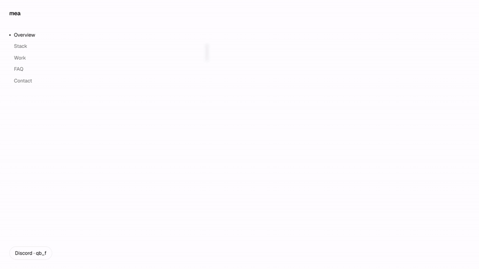

<picture>
  <source media="(prefers-color-scheme: dark)" srcset="./.github/assets/header-dark.svg">
  
</picture>

<br>

### About

Freelance developer. I build websites and web apps from the first screen to the server: small codebases, quick load times, and interfaces that feel effortless.

<br>

### Portfolio

**[purmea.vercel.app](https://purmea.vercel.app)** ↗

<picture>
  <source media="(prefers-color-scheme: dark)" srcset="./.github/assets/shot-hero-dark.png">
  
</picture>

<table>
  <tr>
    <td width="40%"></td>
    <td width="40%"></td>
    <td width="20%"></td>
  </tr>
</table>



<sub>▶ <a href="./.github/assets/site-tour.mp4">Watch the full site tour</a> · <a href="./.github/assets/demo-copy.mp4">Copy demo</a></sub>

<sub>Built with Vite. Source in this repository.</sub>

<br>

### Preferred stack

<p>
  
</p>

| | |
|---|---|
| **TypeScript / TSX** | Typed React components, end to end |
| **Vite** | Instant dev server, lean production builds |
| **Tailwind CSS** | Consistent, responsive UI without the bloat |
| **Node.js** | APIs and server logic in the same language |

<br>

### Work with me

Available for freelance projects: websites, landing pages and web apps.

**Discord** &nbsp;`qb_f`

<br>

<sub>mea · freelance developer</sub>

## Website requests (`/request`, `/track`, `/admin`)

Clients describe the site they want on **/request**. Each request gets a private page, **/track?t=…**, where the client sees your quote, pays by card (Stripe) or crypto, and gets the site once you deliver. You manage everything on **/admin**.

**Flow:** request → you send a price and a delay → client pays (card: automatic; crypto: they paste the transaction ID and you confirm it) → you deliver a link (zip, GitHub, Drive…) → it appears on their page, only once paid.

### Setup on Vercel (Project → Settings → Environment Variables)

| Variable | Needed | What |
| --- | --- | --- |
| Upstash for Redis | **yes** | Vercel → Storage → *Upstash for Redis* → connect to this project (free). Sets `KV_REST_API_URL` and `KV_REST_API_TOKEN`. |
| `ADMIN_TOKEN` | **yes** | Password for /admin. Generate one: `openssl rand -hex 24`. Mark it Sensitive. |
| `SITE_URL` | yes | Your public URL, e.g. `https://mea.is-a.dev`. Used in links. |
| `DISCORD_WEBHOOK_URL` | recommended | Ping for every new request and payment. Discord channel → Settings → Integrations → Webhooks. |
| `STRIPE_SECRET_KEY` | for card | Restricted key (`rk_…`) with *Checkout Sessions: write*. |
| `WALLET_BTC`, `WALLET_ETH`, `WALLET_SOL`, `WALLET_USDT` | for crypto | Your public receiving addresses. Set only the ones you accept. `WALLET_USDT_NETWORK` defaults to `Ethereum (ERC-20)`. |
| `RESEND_API_KEY`, `MAIL_FROM` | optional | Emails the client when the request is received, quoted and delivered. |

Until Upstash is connected, /request politely points visitors to Discord instead of accepting requests.

### Run it locally

```bash
npm run build
ADMIN_TOKEN=dev-token-0123456789abcdefghij npx tsx scripts/dev-server.mts
```

Then open http://localhost:4321/request (data is kept in memory).
